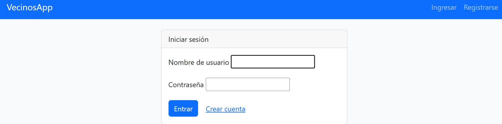
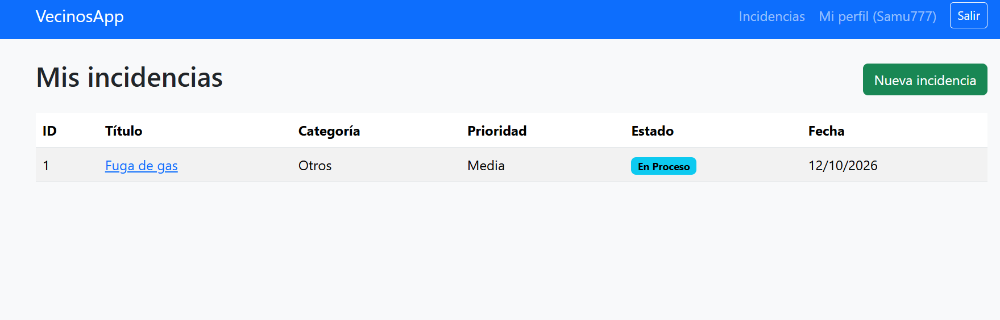
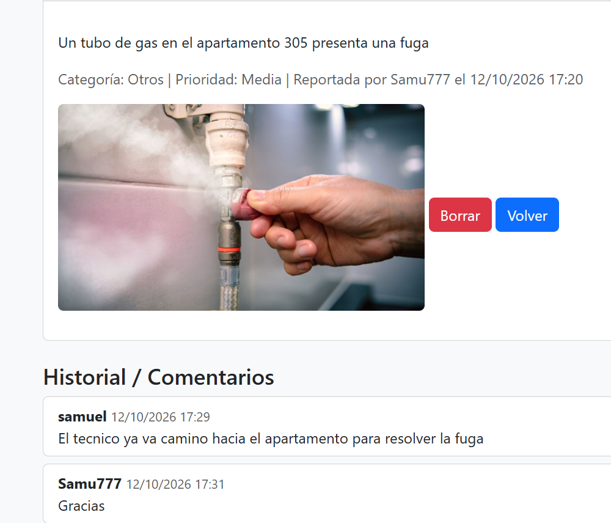

# VecinosApp

Plataforma web hecha con Django para que los residentes de un edificio reporten incidencias
y el administrador las gestione.

## Funciones
- Registro, login y perfil (piso/puerta y edificio)
- Roles: Residente y Administrador
- CRUD de incidencias con foto, estados y comentarios
- Panel de administración personalizado

## Cómo clonar el proyecto
    git clone https://github.com/samavalenciar-dev/vecinosapp.git
    cd vecinosapp

## Crear el entorno virtual e instalar dependencias
    python -m venv EntornoV
    .\EntornoV\Scripts\activate
    pip install -r requirements.txt

## Aplicar migraciones y crear superusuario
    py manage.py migrate
    py manage.py createsuperuser

## Crear los grupos
Entrar a /admin y crear los grupos `Administrador` y `Residente`.
Agregar el superusuario al grupo `Administrador`.

## Ejecutar
    py manage.py runserver

## Capturas de pantalla

